# Underemployment in the Philippines, 2025

Analysis of the $12$ monthly $2025$ Labor Force Survey Public Use Files (Philippine Statistics Authority). Every figure PSA publishes was recomputed and matches ($4,229 / 4,229$ checks passed).

**Navigation:** **Main Report** $\cdot$ [**PSA Survey Plan, PUF Metadata & Math (`methodology.html`)**](methodology.html) $\cdot$ [**Source Code (`GitHub`)**](https://github.com/KingSSIBAL/LFS-2025-Analysis)

<nav aria-label="Contents">
<strong>Contents</strong>
<ul style="list-style: none; padding-left: 0;">
  <li><a href="#findings">Key findings</a></li>
  <li><a href="#sector">1. By broad sector</a></li>
  <li><a href="#who">2. Who is underemployed</a></li>
  <li><a href="#visible">3. Visible vs. invisible</a></li>
  <li><a href="#monthly">4. Monthly pattern</a></li>
  <li><a href="#region">5. By region</a></li>
  <li><a href="#deeper">6. Deeper breakdowns</a></li>
  <li><a href="#trust">Can these numbers be trusted?</a></li>
  <li><a href="#why-unreliable">Why are some small cells flagged as "unreliable" — and how can they be improved?</a></li>
  <li><a href="#limits">Limitations</a></li>
  <li><a href="#recommendations">Recommendations for future research</a></li>
  <li><a href="#data">Data, math, and code</a></li>
</ul>
</nav>

**Key terms.** *Underemployed*: employed, but wants more hours of work. *Visibly underemployed*: worked under $40$ hours. *Invisibly underemployed*: already worked $40$ hours or more and still wants more. *Group rate* ($\hat{Y} _ d / \hat{X} _ d$): underemployed as a share of the employed in that group. *Pool share* ($\hat{Y} _ d / \hat{Y}$): a group's share of all $5.8\text{M}$ underemployed workers nationally. *Visible share* ($\hat{Y} _ d^{\text{vis}} / \hat{Y} _ d$): the share of a group's underemployed who work under $40$ hours. See [**PSA Survey Plan, PUF Metadata & Math**](methodology.html) for the [full PSA Master Sample plan](methodology.html#psa-plan), [PUF variable dictionary](methodology.html#metadata), and [exact variance formulas](methodology.html#estimators).

Annual figures are the average of the $12$ monthly rounds. Regional figures are the average of the $4$ quarterly rounds (January, April, July, October), the only rounds designed for regional estimates.

## Key findings {#findings}

| Finding | Number | Detail |
|---|---|---|
| Underemployed, average per month | $5.8\text{ million}$ | $11.9\%$ of $49.0\text{ million}$ employed |
| Highest-rate sector: agriculture | $17.5\%$ | $3$ in $4$ of them work under $40$ hours |
| Largest group: services | $51\%$ | of all underemployed, but the lowest rate ($9.8\%$) |
| Men vs. women | $13.3\%$ vs. $9.9\%$ | men are two-thirds of the underemployed |
| No schooling vs. college graduates | $18.6\%$ vs. $6.7\%$ | the rate falls steadily with education |
| Peak vs. low month | $14.8\%$ vs. $8.0\%$ | July vs. December |
| Highest vs. lowest region | $28.8\%$ vs. $5.3\%$ | SOCCSKSARGEN vs. Davao |

**The main message:** the sector with the most underemployed workers (services) is not the sector where workers are most likely to be underemployed (agriculture).

*Tip: click any figure to expand it in place (press Esc to close). Hatched bars mark rare demographic cells with $\text{CV} \in (10\%, 20\%]$ (`*`, use with caution) or $\text{CV} > 20\%$ (`**`, unreliable; [see why and how to remedy them below](#why-unreliable)).*

## 1. By broad sector {#sector}

[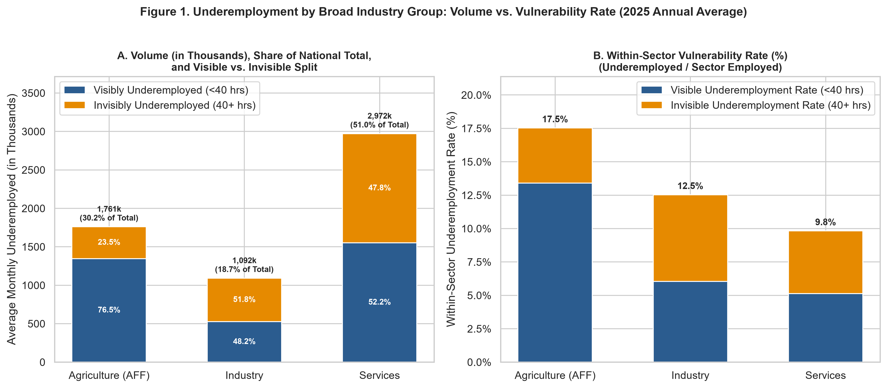](output/figures/fig1_broad_sector_overview_2panel.png)

**Services hold half of the underemployed ($51\%$), but agriculture has the highest rate ($17.5\%$).** In agriculture, $3$ in $4$ underemployed workers work under $40$ hours; in services and industry, visible and invisible underemployment split almost evenly.

## 2. Who is underemployed {#who}

[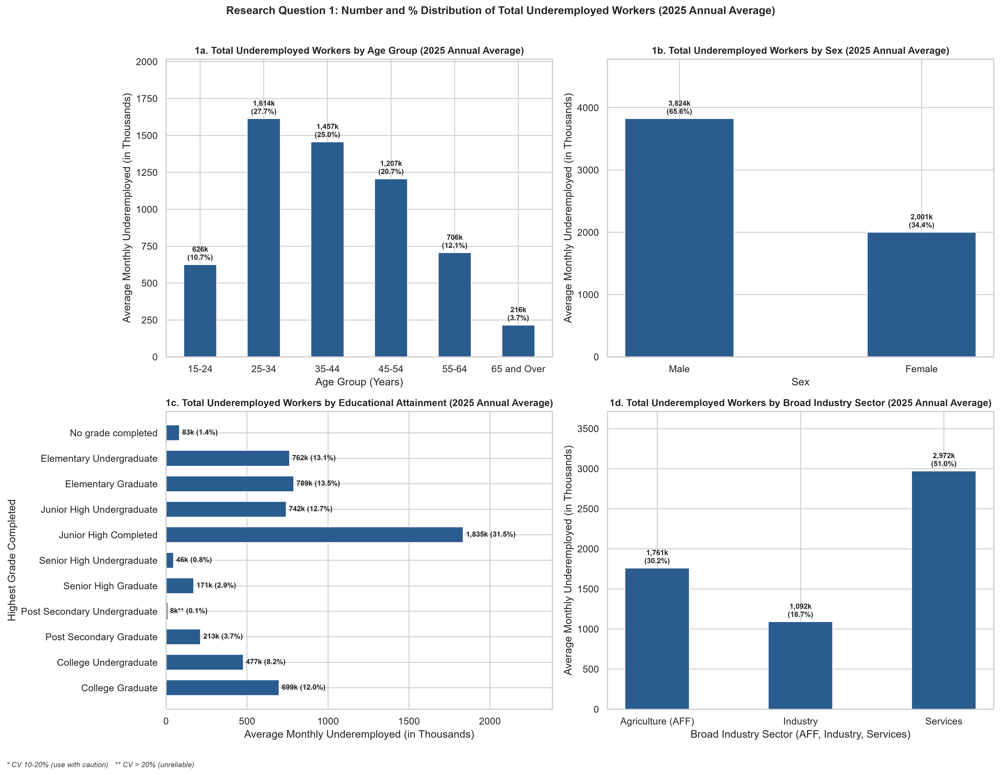](output/figures/fig_RQ1_total_underemployment_4panel.png)

**Men make up two-thirds of the underemployed pool and face a higher within-group rate than women ($13.3\%$ vs. $9.9\%$).** While the chart above plots each group's headcount and *pool share* of the $5.8\text{M}$ national total, the *within-group rate* falls steadily with schooling—from $18.6\%$ (no grade completed) to $6.7\%$ (college graduates). Post-secondary undergraduates (`**`, $\text{CV} = 22.7\%$) represent a tiny fraction of the national workforce, leaving too few sampled individuals per barangay to read reliably on a single-year basis. By age, the rate stays at $11\text{--}13\%$ until dropping to $7.8\%$ at $65$ and over.

## 3. Visible vs. invisible underemployment {#visible}

[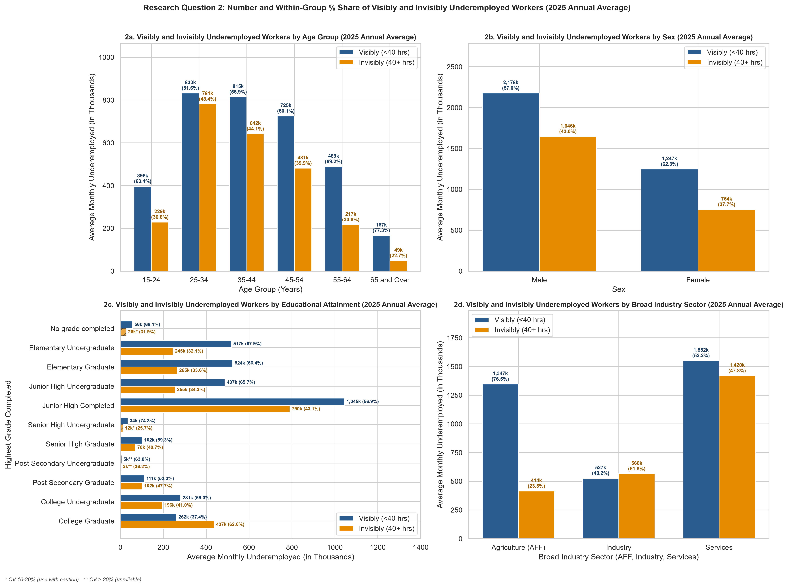](output/figures/fig_RQ2_visible_invisible_4panel.png)

**Underemployed college graduates mostly work full time already:** only $37\%$ of underemployed graduates work under $40$ hours (visibly underemployed), compared with $77\%$ in agriculture and $77\%$ among workers aged $65$ and over.

## 4. Monthly pattern {#monthly}

[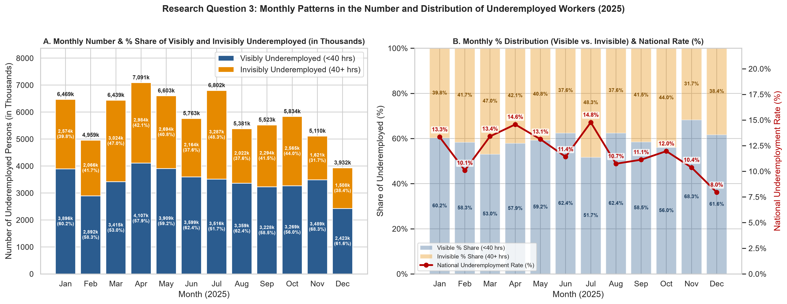](output/figures/fig_RQ3_monthly_number_and_distribution.png)

**The rate peaks in July ($14.8\%$) and April ($14.6\%$) and hits its low in December ($8.0\%$).** Monthly standard errors run $0.2\text{--}1.0$ percentage points, ruling out sampling noise. April reflects dry-season agricultural slack between planting and harvest cycles, July reflects southwest monsoon (*habagat*) and early typhoon disruptions to outdoor working hours, and December reflects Q4 holiday retail/hospitality expansion alongside $13$th-month pay and remittance inflows.

[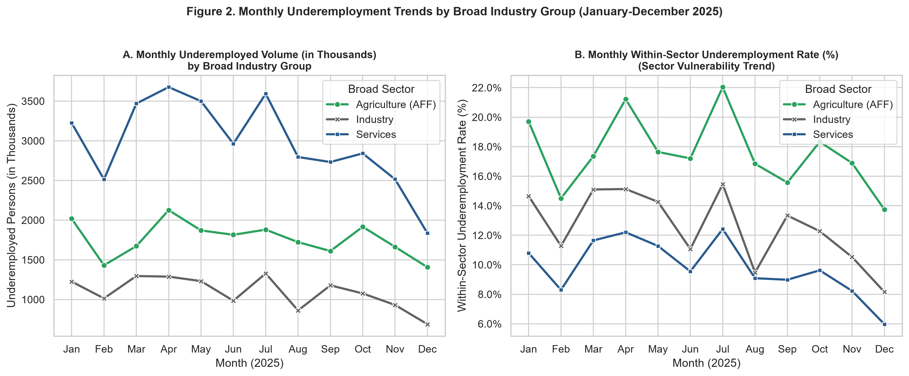](output/figures/fig2_monthly_sector_trends_2panel.png)

**All three sectors move together:** each peaks in July and bottoms out in December. Agriculture ranges from $13.7\%$ to $22.0\%$, services from $6.0\%$ to $12.4\%$.

[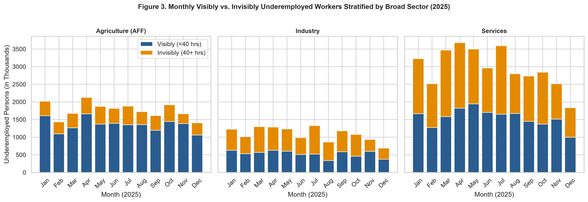](output/figures/fig3_monthly_visible_invisible_by_sector.png)

**Visible (short-hour) underemployment drives the April and July spikes across all sectors, while invisible (full-time) underemployment forms a steadier baseline.**

## 5. By region {#region}

[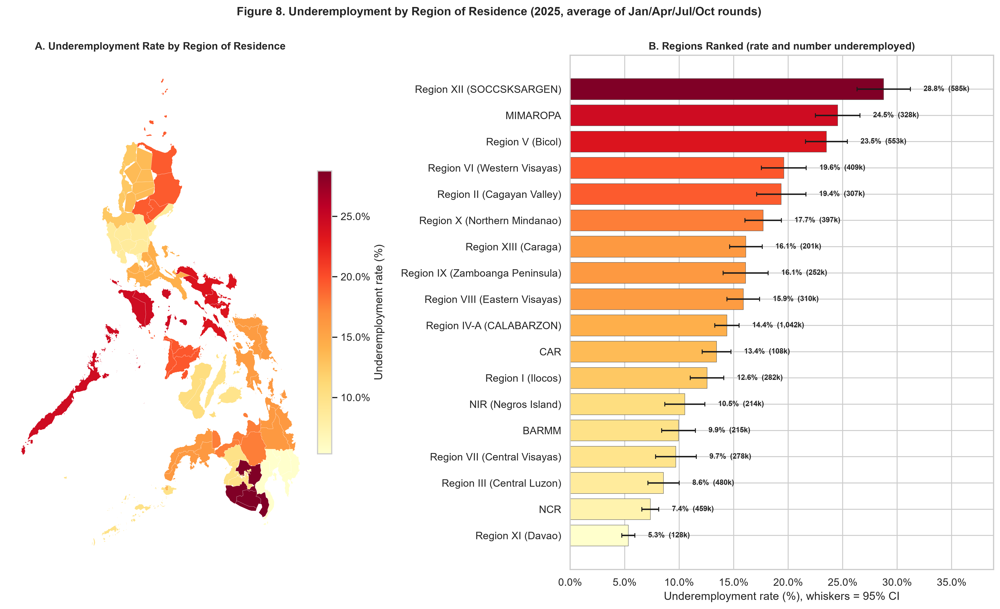](output/figures/fig8_region_map.png)

**Regions differ five-fold: SOCCSKSARGEN ($28.8\%$), MIMAROPA ($24.5\%$), and Bicol ($23.5\%$) rank highest; Davao ($5.3\%$) and NCR ($7.4\%$) rank lowest.** Whiskers show $95\%$ confidence intervals; non-overlapping intervals indicate conservative, statistically distinct pairs ($p \approx 0.006$, while intervals overlapping by less than $29\%$ of a whisker arm still differ at the $5\%$ level; see the [math proof](methodology.html#reliability)).

**Residence vs. workplace commuter shift:** Official PSA tables classify workers by their *region of residence* (`R*` tables). When underemployed workers are tabulated by their *region of workplace* (`W*` tables, derived from the province/municipality of work code `PUFC12A_PROVMUN`), daily commuting across metropolitan borders shifts the regional distribution: NCR's underemployed headcount is $19\%$ higher by workplace than by residence, while neighboring CALABARZON's is $11\%$ lower.

## 6. Deeper breakdowns {#deeper}

[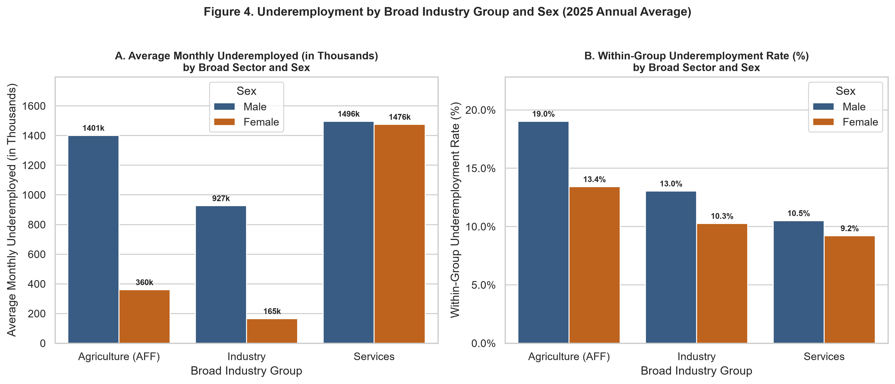](output/figures/fig4_sector_by_sex_2panel.png)

**The gap between men and women is widest in agriculture ($19.0\%$ vs. $13.4\%$).** In services, the rates sit close ($10.5\%$ vs. $9.2\%$) and headcounts are nearly equal.

[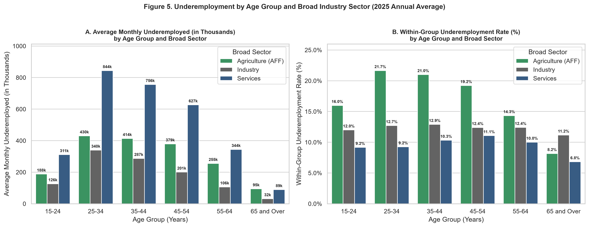](output/figures/fig5_sector_by_age_2panel.png)

**Agricultural workers aged $25\text{--}34$ face the highest rate of any age group in any sector ($21.7\%$).**

[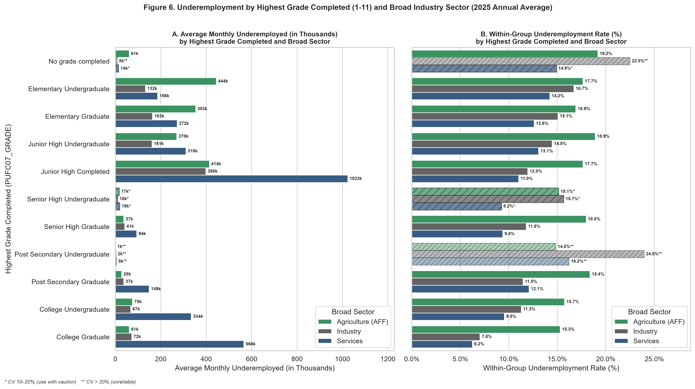](output/figures/fig6_sector_by_education_2panel.png)

**Education lowers the rate in industry and services, but much less in agriculture:** college graduates in agriculture still face a $15.3\%$ rate. Hatched bars flag rare cross-tabulated cells with high relative sampling variance (`*` $\text{CV} \in (10\%, 20\%]$, `**` $\text{CV} > 20\%$, such as workers with no schooling in formal industry).

[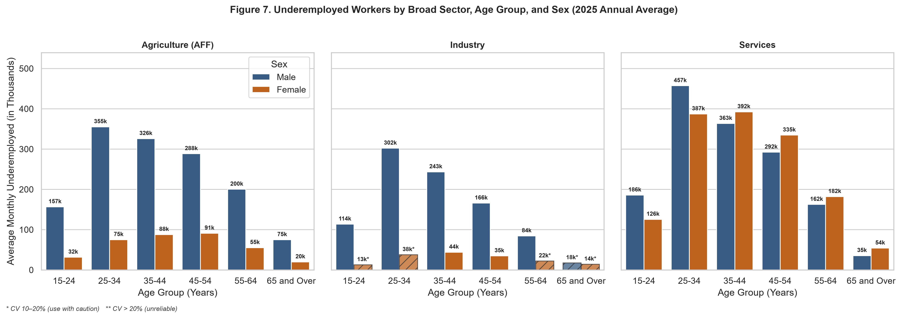](output/figures/fig7_sector_age_sex_3way.png)

**The largest single demographic cell is men aged $25\text{--}34$ in services ($457,000$ a month).**

**What the breakdowns mean together:** Underemployment in the Philippines is two distinct problems under one headline number—an *hours-shortage* problem in agriculture (where $77\%$ of the underemployed work under $40$ hours and rates spike during the April dry season and July monsoon) and an *earnings-adequacy* problem in services and among college graduates (where $63\%$ of the underemployed already work $40+$ hours a week).

## Can these numbers be trusted? {#trust}

| Technical Specification | Detail |
|---|---|
| **Microdata Source** | PSA Labor Force Survey (LFS) Public Use Files, January–December 2025 ($12$ rounds; [see full PUF dictionary](methodology.html#metadata)) |
| **Target Population** | Employed persons aged $15+$ excluding overseas workers ($\bar{X} = 49,024.506\text{k}$ average per month) |
| **Sampling & Variance Design** | [2023 Geo-enabled Master Sample](methodology.html#psa-plan): $117$ province/HUC strata, contiguous PSU clustering with island reunification, $2$-stage FPC ($B _ {\text{urb}} = 25$, $B _ {\text{rur}} = 15$), Taylor series linearization |
| **Official Validation** | $4,229 / 4,229$ published PSA Special Release figures matched ($3,576$ monthly, $77$ annual, $576$ regional; [see table map](methodology.html#validation-map)) |
| **Standard Error Accuracy** | $0.9999\times$ median / $1.0020\times$ mean ($0.30\%$ MAPE, range $0.997\text{--}1.021\times$) nationally ($12$ months) and $0.9992\times$ median / $0.9996\times$ mean ($0.22\%$ MAPE, range $0.991\text{--}1.040\times$) regionally ($72$ cells) |
| **Reliability Flag Bands** | $\text{CV} \le 10\%$ reliable, $10\text{--}20\%$ (`*`) use with caution, $> 20\%$ (`**`) unreliable |

## Why are some small cells flagged as "unreliable" — and how can they be improved? {#why-unreliable}

Seeing a cell flagged as **use with caution** ($\text{CV} \in (10\%, 20\%]$) or **unreliable** ($\text{CV} > 20\%$) does **not** mean there is a calculation error or data defect—our pipeline passes $4,229 / 4,229$ official PSA validation checks with zero failures. Instead, high Coefficients of Variation ($\text{CV} = \text{SE} / \text{Estimate}$) arise naturally in any sample survey when slicing the population into very small demographic cells:

1. **Why they happen (rare real-world subgroups & clustered barangay sampling):** When you cross-tabulate $11$ education levels by $3$ sectors (Figure 6), some combinations barely exist in the Philippine workforce—for example, very few workers in formal *Industry* have *no grade completed*, and very few workers overall are *Post-Secondary Non-Tertiary Undergraduates* ($\text{CV} = 22.7\%$, people who started a short TVET certificate, left before graduating, are employed, and want extra hours). Because the LFS samples households in geographic clusters (barangays/PSUs), most PSUs have $0$ respondents in a rare cell while a few PSUs have $1$ or $2$, causing the relative error ($\text{CV} \propto 1/\sqrt{M _ d}$) to exceed $20\%$.
2. **Why we keep them uncollapsed here:** We preserve all $11$ education categories uncollapsed in our main tables and figures so that every marginal total matches PSA's published $11$-category education schema (`educ_sex_age` and `educ_region_sex`) to the exact decimal.
3. **Three standard statistical methods to improve high-CV cells** ([see full mathematical derivations in `methodology.html#remedies`](methodology.html#remedies)):
   * **Category Collapsing (Design-Based, Zero Model Bias):** Merging adjacent sparse categories—such as combining *Post-Secondary Undergraduate* (`educ_code = 8`) and *Post-Secondary Graduate* (`educ_code = 9`) into a single **Post-Secondary / TVET** group, or grouping *No grade completed* with *Elementary Undergraduate*—increases the number of non-zero PSU clusters ($M _ D = M _ {d _ 1} + M _ {d _ 2}$) and brings the combined $\text{CV}$ down into the reliable ($\le 10\%$) band.
   * **Multi-Year Wave Pooling (Temporal Borrowing of Strength):** Pooling $T = 3$ consecutive years of LFS Public Use Files (e.g., $2023\text{--}2025$, $36$ monthly rounds) triples the effective sample size and reduces the $\text{CV}$ by approximately $1/\sqrt{3} \approx 0.58\times$ (bringing a $22.7\%$ CV down to $\approx 13.1\%$).
   * **Fay-Herriot Small Area Estimation (SAE / Empirical Bayes Shrinkage):** Following the methodology used by the PSA and Asian Development Bank (ADB) for small-area poverty and labor indicators, direct survey estimates $\bar{Y} _ d$ with high sampling variance $V(\bar{Y} _ d)$ can be blended with regression predictions from Census of Population and Housing (CPH) or TESDA administrative covariates via an Empirical Best Linear Unbiased Predictor (EBLUP), shrinking the Mean Squared Error well below the direct survey variance.

## Limitations {#limits}

### A. Public Use File (PUF) Anonymization & Frame Constraints
- **Inferred Residence Strata ($117$ Master Sample Domains):** Province/HUC of residence is the official sampling stratum, but the anonymized PUF includes only regional codes (`PUFREG`), and only in the $4$ quarterly rounds. Reconstructing the $117$ strata from each PSU's modal province of work (`PUFC12A_PROVMUN`, constrained to `PUFREG` in quarterly rounds and to the 3-step smoothed residence-region block `eff_reg` in monthly rounds) and repairing commuter PSUs via 3-step geographic neighbor smoothing leaves minor boundary misassignments in heavy within-region commuter corridors.
- **Repeated PSU Codes & Split Clusters:** Because `PUFPSU` codes repeat across provinces, rebuilding PSUs as contiguous runs of `PUFRPL` + `PUFPSU` + `PUFREG` along household IDs (`PUFHHNUM`) and reuniting split fragments within the same domain via gap-and-islands clustering (`< 150` household IDs and $\le 30$ combined households) closely recovers the Master Sample cluster structure, though a handful of boundary PSUs remain split.
- **Unpublished Frame Counts ($B _ {p,a}$ and $A _ p$):** Exact housing-unit counts per PSU ($B _ {p,a}$) and PSU counts per domain ($A _ p$) are confidential frame variables. Calibrating effective second-stage frame sizes via `PUFURB2020` ($B _ {\text{urb}} = 25$, $B _ {\text{rur}} = 15$) achieves a $0.30\%$ national MAPE ($0.997\text{--}1.021\times$) and $0.22\%$ regional MAPE ($0.991\text{--}1.040\times$), with the remaining minor dispersion driven by unpublished barangay-level frame sizes and post-stratification adjustments.
- **Omission of Housing-Unit IDs & Calibration Adjustment Factors:** The PUF provides only the final calibrated weight (`PUFPWGTPRV`) without intermediate non-response or post-stratification factors, and omits second-stage housing-unit IDs (where at most $3$ households per housing unit are sampled), slightly understating within-PSU household clustering.

### B. Multi-Round Pooling & Sub-National Coverage Constraints
- **Suppressed Rotational Panel Identifiers:** The LFS Master Sample uses a rotating panel where households are interviewed across multiple quarters, inducing positive serial covariance across rounds ($\text{Cov}(\hat{Y} _ m, \hat{Y} _ {m'}) > 0$). Because longitudinal household linkage keys are suppressed in the public microdata, our annual ($K=12$) and quarterly ($K=4$) variance formulas treat rounds as independent cross-sections ($V(\bar{Y}) = \frac{1}{K^2}\sum _ {m=1}^{K} V(\hat{Y} _ m)$), which slightly understates true multi-round standard errors.
- **Quarterly-Only Regional Design (`R*`):** The $8$ non-quarterly rounds (Feb, Mar, May, Jun, Aug, Sep, Nov, Dec) deploy only $1$ sample replicate designed strictly for national estimates; reliable residence-region estimates (`R*`) can only be computed from the $4$ quarterly rounds (Jan, Apr, Jul, October).
- **Indirect Verification of Multi-Way & Workplace Tables:** PSA does not publish underemployment by education, multi-way sector interactions (sector $\times$ sex/age/education), or region of workplace (`W*`). These tables are verified indirectly by asserting that their cells sum exactly to checked national and regional margins.

### C. Conceptual & Labor Market Measurement Constraints
- **Time-Related Definition vs. Wage Data Absence:** Following ILO and PSA standards, underemployment is defined strictly by wanting additional hours of work (`PUFC20_PWMORE = 1`). Because daily basic pay and wage variables are omitted from the 2025 LFS PUF release, *invisible underemployment* ($40+$ hours) serves as a behavioral proxy for inadequate earnings rather than a direct measure of low hourly wages.
- **Scope Exclusions:** Following PSA Technical Notes (p. 1), the target population excludes Overseas Filipino Workers (OFWs) and measures underemployment strictly among employed persons, excluding unemployed jobseekers and discouraged workers outside the labor force.

## Recommendations for future research {#recommendations}

### A. Empirical & Labor Market Research Directions (Tied to 2025 Findings)
1. **Unpack the $63\%$ Invisibly Underemployed College Graduates and the $457,000$ Prime-Age Male Services Cell via Occupation and Class-of-Worker Models:** Our results show that services hold $51\%$ of all underemployed workers (led by men aged $25\text{--}34$ at $457,000$ per month, Figure 7) and that $63\%$ of underemployed college graduates already work $40+$ hours a week (Figure RQ2), while college graduates in agriculture still face a $15.3\%$ rate (Figure 6). Because the 2025 PUF omits wage variables, future research should cross-tabulate invisible underemployment against major occupation (`PUFC14_PROCC`), class of worker (`PUFC23_PCLASS`), and nature of employment (`PUFC17_NATEM`)—or link quarterly LFS waves to the Family Income and Expenditure Survey (FIES)—to test how much of full-time underemployment is driven by self-employed/informal work versus skills-to-occupation mismatch among degree holders.
2. **Isolate Weather Shocks vs. Crop Structure Behind the April ($14.6\%$) / July ($14.8\%$) Spikes and the $5\times$ Mindanao Regional Gap:** In Section 4, visible ($<40$ hours) underemployment drives the national surge from $8.0\%$ in December to $14.6\%$ in April and $14.8\%$ in July (with agriculture swinging from $13.7\%$ to $22.0\%$). At the same time, Section 5 reveals a five-fold gap between neighboring Mindanao regions: SOCCSKSARGEN ($28.8\%$) versus Davao ($5.3\%$). Future studies should merge our $117$ reconstructed province/HUC monthly series with PAGASA rainfall/typhoon anomalies and PSA crop-production data to test why young agricultural workers aged $25\text{--}34$ ($21.7\%$ rate, Figure 5) and men in agriculture ($19.0\%$ vs. $13.4\%$ for women, Figure 4) face acute seasonal hours shortages in seasonal grain regions (SOCCSKSARGEN, MIMAROPA $24.5\%$, Bicol $23.5\%$) compared with perennial plantation economies (Davao).
3. **Model Bilateral Commuting Flows Behind the $+19\%$ NCR / $-11\%$ CALABARZON Workplace-Residence Shift:** Section 5 shows that tabulating workers by *workplace* (`W*`) rather than *residence* (`R*`) raises NCR's underemployed count by $19\%$ and lowers CALABARZON's by $11\%$. Future spatial labor research should use the quarterly rounds (where both residence region `PUFREG` and workplace province/municipality `PUFC12A_PROVMUN` are observed) to construct origin-destination commuter matrices across Greater Manila (NCR, CALABARZON, Central Luzon) and test whether cross-border commuters experience higher *invisible* underemployment ($40+$ hours) to compensate for commuting costs.

### B. Survey Methodology & Variance Research Directions
1. **Apply Multi-Year Wave Pooling ($2023\text{--}2025$) and Fay-Herriot SAE to High-CV Education $\times$ Sector Cells:** To estimate underemployment precisely for rare cells flagged in Figures RQ1, RQ2, and 6—specifically *Post-Secondary Undergraduates* ($\text{CV} = 22.7\%$) and sparse *Education $\times$ Sector* cells like *No grade completed in Industry*—without losing the $11$-category PSA education classification, future research should pool the $2023\text{--}2025$ LFS PUF waves ($36$ rounds, cutting CVs by $1/\sqrt{3} \approx 0.58\times$) or fit a Fay-Herriot area-level model linking our direct two-stage estimates to 2024 Census of Population (POPCEN) and TESDA administrative covariates ([see equations in `methodology.html#remedies`](methodology.html#remedies)).
2. **Incorporate Post-Stratification Calibration Residuals and Bound Rotational Panel Serial Correlation:** Our two-stage variance design ($B _ {\text{urb}} = 25$, $B _ {\text{rur}} = 15$) matches official PSA standard errors to a median of $0.9999\times$ (mean $1.0020\times$, MAPE $0.30\%$, range $0.997\text{--}1.021\times$) nationally and $0.9992\times$ (mean $0.9996\times$, MAPE $0.22\%$, range $0.991\text{--}1.040\times$) regionally. Future methodological work should test regression-calibration residualization against the age-sex-domain post-stratification cells and estimate upper and lower bounds on the unlinked rotational panel covariance $\text{Cov}(\hat{Y} _ m, \hat{Y} _ {m'})$ across quarterly waves.

## Data, math, and code {#data}

- **PSA survey plan, metadata & math formulas:** [**Mathematical Methodology, PSA Survey Plan & PUF Metadata (`methodology.html`)**](methodology.html)
- **All tables:** [Excel workbook](output/LFS_2025_Stratified_Underemployment_Tables.xlsx) $\cdot$ [CSV files](https://github.com/KingSSIBAL/LFS-2025-Analysis/tree/main/output/tables) (`RQ1_RQ2_*` and `RQ3_*` correspond to Sections 2, 3, and 4)
- **Code and how to re-run:** [repository README](https://github.com/KingSSIBAL/LFS-2025-Analysis#readme)
- **Data:** Philippine Statistics Authority, Labor Force Survey 2025 Public Use Files and Special Release tables. Map boundaries: [faeldon/philippines-json-maps](https://github.com/faeldon/philippines-json-maps) (MIT).

<footer>The analysis and any errors are ours, not PSA's.</footer>

<dialog id="lightbox" aria-label="Expanded figure">
  
</dialog>

